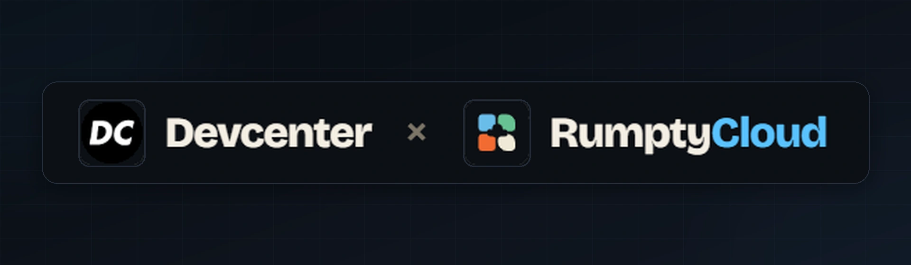
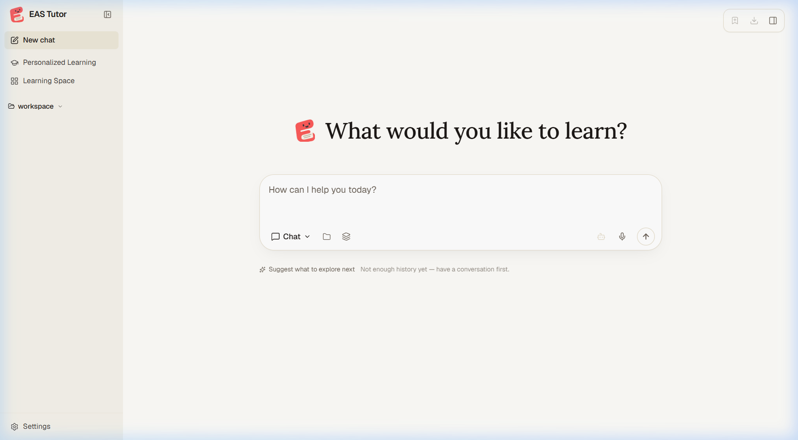
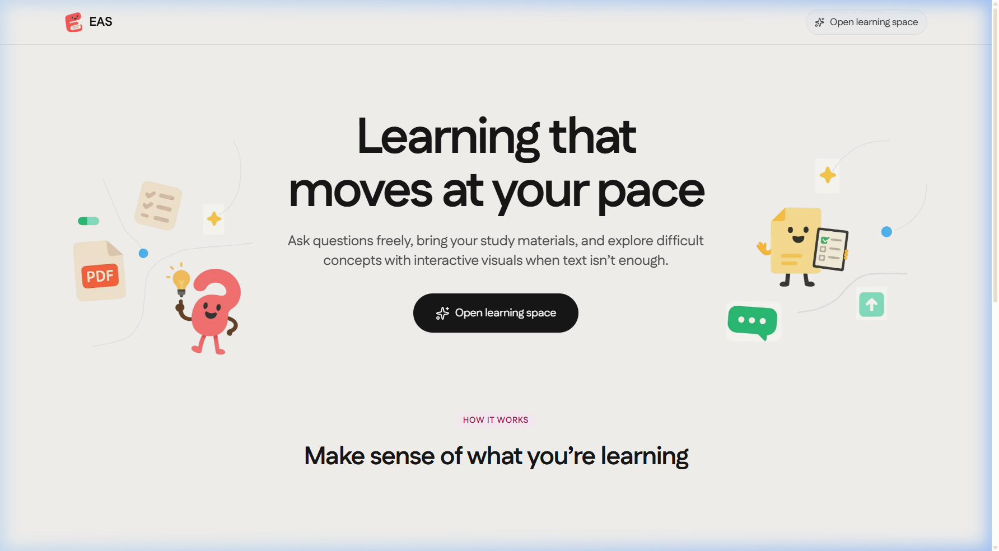
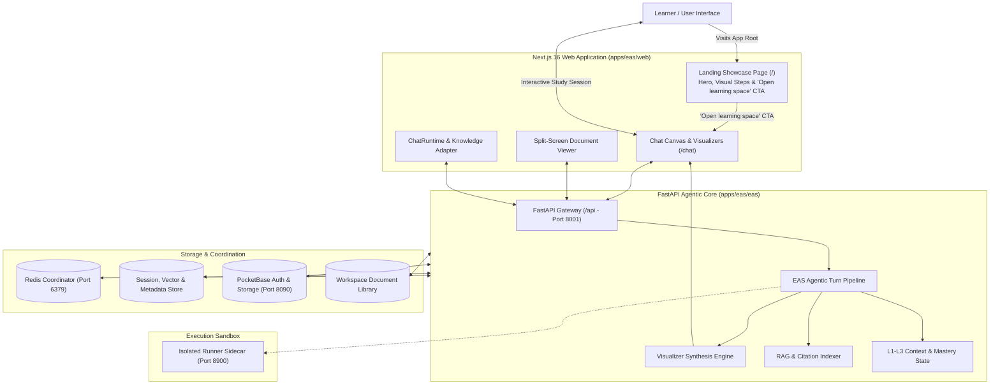

<p align="center">
  
</p>

<p align="center">
  
</p>

<h1 align="center">EAS (An Educational Agentic System)</h1>

<p align="center">
  A web-based learning engine that changes how a concept is explained when text is not enough.
</p>

<p align="center">
  <a href="https://fastapi.tiangolo.com/"></a>
  <a href="https://nextjs.org/"></a>
  <a href="https://www.python.org/"></a>
  <a href="https://www.typescriptlang.org/"></a>
  <a href="https://www.docker.com/"></a>
  <a href="apps/eas/LICENSE"></a>
</p>

---

## Experience Preview

<div align="center">
  <h3>1. Interactive Learning Workspace</h3>
  

  <br /><br />

  <h3>2. Landing Page</h3>
  
</div>

---

## Why EAS Exists

A correct explanation is not always a helpful explanation.

A learner can read the same paragraph several times, ask an AI assistant to explain it differently, and still walk away without understanding the underlying concept. Sometimes, what is missing is not more text. It is a worked example, a diagram, a table built step by step, or an interactive model that makes an abstract idea easier to see.

That gap is what EAS is built to address.

EAS is a web-based interactive learning engine designed to make difficult concepts intuitive to explore, whether asking questions freely or studying directly from course material. Rather than treating every question as a request for another block of text, EAS dynamically changes how a concept is taught when another representation helps.

The goal is straightforward: help learners move from reading an explanation to genuinely understanding what it means and how it works.

---

## Problem Statement

Traditional AI tutors fail learners in three critical ways:

1. **Walls of Text Cause Cognitive Friction:** When learning complex scientific, medical, and engineering subjects (such as physical mechanics, biological systems, anatomical pathways, or abstract algorithmic models), dense text explanations overwhelm students and fail to spark visual intuition.
2. **Hallucination from Context Degradation:** In extended study sessions that build on prior explanations, standard chatbots aggressively truncate or compact earlier memory, causing the model to lose key context, misremember derivations, and hallucinate answers.
3. **Inflexible Problem Scaffolding:** Even advanced models tend to default to direct answer delivery rather than actively diagnosing cognitive bottlenecks and scaffolding the problem adaptively where the student experiences friction.

---

## The Idea

EAS brings conceptual exploration, interactive visual models, and optional study materials into one continuous experience.

A learner can explore a topic from scratch or attach lecture notes and textbooks to anchor the discussion in their actual curriculum, moving seamlessly between text, visual models, and source passages.

The system is designed around four connected principles:

- **Flexible Grounding:** Ask questions freely without uploading anything, or attach syllabus materials and lecture notes to anchor explanations with traceable, page-level citations.
- **Adaptive Teaching:** Recognize signals that another explanation is needed and adjust the teaching approach when appropriate.
- **Interactive Understanding:** Use visual representations and guided interactions to make relationships, processes, and abstract concepts easier to explore.
- **Continuity:** Keep questions, dynamic visualizers, conversation history, and optional reference materials within the same unified workspace.

---

## How It Works

The learning loop is structured around five steps:

1. **Ask a question or provide material:** Start with an open conceptual question or upload study documents (PDF, EPUB, DOCX, Markdown).
2. **Build context:** Establish conceptual context from the conversation flow, incorporating uploaded materials and external research whenever present.
3. **Explain the concept:** Present a clear explanation, complete with clickable source citations whenever referenced documents are available.
4. **Change the representation when useful:** Synthesize an interactive diagram, step-by-step table, circuit schematic, or visual simulation rather than rephrasing text.
5. **Continue learning:** Verify understanding through interactive checks, ask follow-up questions, inspect referenced passages if documents were provided, and explore related concepts.

---

## Current Capabilities

> **Release Note (v1.0.0):** In the current release, learners activate visualizers and study modes directly via the chat controls and `/visualize` command. Fully autonomous modality detection (where the engine decides when an interactive visual is needed and selects the best format without manual toggling) is actively in development for the upcoming v1.0.1 release.

### 1. Interactive Visualizer Engine (`/visualize`)
- Synthesizes dynamic visual components directly in the conversation flow when invoked via `/visualize` or configured in visualizer settings.
- **Interactive Simulations and Models:** Sandboxed interactive HTML/Canvas simulations for physical mechanics, orbital trajectories, biological pathways, chemical equilibria, and electrical circuits with real-time sliders and parameters.
- **2D and 3D Mathematical Constructions:** Interactive geometry, vector fields, calculus surfaces, and 3D coordinate models powered by GeoGebra.
- **Scientific and Explanatory Diagrams:** Custom vector illustrations (SVG) and structured flowcharts (Mermaid, Mindmaps) for anatomical structures, physiological processes, sequence flows, and hierarchical concept maps.
- **Dynamic Charts and Data Analytics:** Quantitative data visualizers powered by Chart.js (distributions, radar profiles, multi-series trends, and scatter relationships).
- **Mathematical Motion Animations:** High-precision programmatic algebraic transformations and geometric derivations powered by Manim (available as an optional extra).

### 2. Grounded Document Ingestion and Precision Citations
- Ingests textbook chapters, research papers, and lecture notes in PDF, EPUB, DOCX, XLSX, PPTX, and Markdown formats.
- Employs hybrid indexing combining dense vector embeddings with BM25 keyword retrieval via LlamaIndex.
- Dedicated split-screen Reading Workspace displays original document pages side-by-side with chat.
- Clickable citation badges in responses jump directly to the referenced page and locator coordinates.

### 3. Guided Learning and Interactive Choice Cards
- Multi-step cognitive pipeline: **Explore -> Reason -> Plan -> Synthesize -> Verify**.
- Step-by-step problem scaffolding: guides learners to solve problems incrementally rather than leaking full answers upfront.
- **Interactive Choice Cards (`ask_user`):** When the agent needs clarification or decision points from the user, it renders interactive, clickable option cards directly in the chat bubble.
- **Mastery Check-in Quizzes:** In Mastery study mode, the tutor presents interactive question cards with multiple-choice options, automated grading, and review feedback.

### 4. Deep Research and Multi-Source Synthesis
- Autonomous multi-step research agent that executes recursive search and literature synthesis.
- Integrated search capabilities using DuckDuckGo Search (`ddgs`) and ArXiv academic paper retrieval (`arxiv`).
- Produces structured research reports with citations and verified source links.

### 5. Mastery Paths and Practice Bank
- **Topic Atlas and Learning Boards:** Organizes curriculum topics into structured modules, knowledge points, and review trails under the Mastery workspace.
- **Practice and Mistakes Log:** Tracks question history, wrong-answer reviews, and spaced repetition intervals across study sessions.

---

## System Architecture



---

## Technology Stack

| Layer | Technologies |
|---|---|
| **Frontend** | Next.js 16 (App Router), React 19, TypeScript 5, Tailwind CSS, Framer Motion, Lucide Icons, Cytoscape.js, Chart.js, Mermaid.js, PDF.js, epub.js, docx-preview, i18next |
| **Backend Core** | Python 3.11 - 3.14, FastAPI 0.115+, Uvicorn, Pydantic v2, aiosqlite, Loguru |
| **Storage & Coordination** | Redis 7.4 (event streaming and session coordination), SQLite (sessions, vectors, metadata), PocketBase (auth and accounts), Local Filesystem |
| **RAG & Document Parsing** | LlamaIndex, FAISS, BM25, PyMuPDF, python-docx, openpyxl, python-pptx, pypdf, pdfplumber; Optional: LightRAG (`lightrag-hku`), GraphRAG, Docling, MarkItDown |
| **Visualizers & Math** | Cytoscape, SVG/Canvas rendering, Manim (optional Math Animator) |
| **Execution Sandbox** | Runner sidecar container with unprivileged user isolation |

---

## Getting Started

### Prerequisites
- [Docker](https://docs.docker.com/get-docker/) and Docker Compose (recommended) **OR**
- Python 3.11+ and Node.js 20+

---

### Option A: Running with Docker (Recommended)

1. **Clone the repository:**
   ```bash
   git clone <your-repo-url>
   cd eas-product/apps/eas
   ```

2. **Configure environment:**
   ```bash
   cp .env.example .env
   ```
   *(Optional: Adjust `HOST_PORT_BACKEND`, `HOST_PORT_FRONTEND`, or `HOST_PORT_POCKETBASE` if defaults are occupied).*

3. **Start the services:**
   ```bash
   docker compose up -d
   ```
   *Alternatively, run `python scripts/docker_compose.py up -d` to load port mappings directly from your configuration.*

4. **Access the application:**
   - **EAS Web Application:** `http://localhost:3782` (Visiting `/` displays the **Landing Page**; clicking *"Open learning space"* enters `/chat`)
   - **FastAPI Backend:** `http://localhost:8001`
   - **Health Ready Check:** `http://localhost:8001/health/ready`

---

### Option B: Running Locally for Development

#### 1. Backend Setup
```bash
cd apps/eas

# Create and activate virtual environment
python -m venv .venv
source .venv/bin/activate  # On Windows: .venv\Scripts\activate

# Install backend dependencies
pip install -r requirements.txt

# Start Redis (required for session coordination)
docker run -d -p 6379:6379 --name eas-redis redis:alpine

# Run FastAPI backend server
python -m eas.api.run_server
```

#### 2. Frontend Web Application Setup
```bash
cd apps/eas/web

# Install dependencies
npm install

# Start development server
npm run dev
```

The application will be available at **`http://localhost:3000`**. Visiting the root URL displays the **Landing Page**, and clicking **"Open learning space"** navigates straight into the interactive chat workspace.

---

### Option C: Hosted Web Access & Free OAuth Sign-In

For learners and students who want to start immediately without installing Docker, managing Python environments, or paying for commercial API keys:

1. **Access the Web App:**
   - Open your deployed EAS web instance in any browser (e.g., `https://<your-eas-deployment-url>`).
   - The landing page greets you with feature walkthroughs; click **"Open learning space"** to enter.

2. **Connect a Free Model via OAuth:**
   - Open **Settings -> Providers -> OpenAI Codex OAuth**, then choose **Open authorization**. Sign in to the ChatGPT account you want to use.
   - EAS is hosted remotely, so the OAuth redirect returns to a `localhost` callback on your own computer. The browser may appear to load or redirect briefly, then show that the page cannot be reached. This is expected: the callback listener is inside the hosted EAS container, not your computer. Do not panic or close the sign-in attempt.
   - Copy the **entire address** from the browser address bar, including everything after `?`, and return to the still-open EAS settings page. Paste it into **Callback address**, then choose **Finish sign-in**.
   - Leave the EAS settings page open and wait a little while for the connection to finish. Do not start another sign-in or click Finish again while it is processing. EAS will show the connection status when it completes. The callback is short-lived, so if it expires, start again and use the new address.
   - Keep the callback address private. It contains a temporary sign-in code and should only be pasted into the EAS page that started the login.

3. **(Optional) Personal API Keys:**
   - If you have personal API keys for other models (OpenAI, Anthropic Claude, DashScope Qwen, Perplexity) or a local Ollama endpoint, you can configure them under **Settings -> Model Providers** at any time.

4. **Start Learning:**
   - Begin asking questions, upload study notes into the Reading Workspace, and generate interactive visualizers.

---

## Configuration

EAS provides configuration via environment variables and settings files stored under `apps/eas/data/user/settings/`.

### Host Port Mapping (`.env`)

| Variable | Default | Description |
|---|---|---|
| `HOST_PORT_BACKEND` | `8001` | Host port mapped to the FastAPI backend |
| `HOST_PORT_FRONTEND` | `3782` | Host port mapped to the Next.js web interface |
| `HOST_PORT_POCKETBASE` | `8090` | Host port mapped to PocketBase auth sidecar |
| `TZ` | `UTC` | Time zone passed into backend and frontend containers |

### LLM Provider Keys

API keys can be supplied via environment variables or configured through the web interface at **Settings -> Model Providers**:

- `OPENAI_API_KEY`: OpenAI model access (GPT-4o, o3-mini, etc.)
- `ANTHROPIC_API_KEY`: Anthropic model access (Claude 3.5 Sonnet, Claude 3.7 Sonnet)
- `DASHSCOPE_API_KEY`: Qwen model access
- `PERPLEXITY_API_KEY`: Perplexity online search model access
- Local LLMs (Ollama, LM Studio, vLLM) are supported by providing a base URL in the Settings UI or in `data/user/settings/model_catalog.json`.

---

## Development and Testing

### Backend Verification
```bash
cd apps/eas

# Run backend test suite
pytest

# Verify architectural boundaries and import layers
python scripts/check_architecture.py
```

### Frontend Verification
```bash
cd apps/eas/web

# Run TypeScript typecheck
npm run typecheck

# Run Node unit tests
npm run test:node

# Run Vitest component tests
npm run test:unit

# Run ESLint
npm run lint

# Run comprehensive fast checks
npm run check:fast
```

---

## Project Structure

```
eas-product/
├── apps/
│   └── eas/                   # Core EAS learning application & unified web platform
│       ├── eas/               # Backend Python core package (Port 8001)
│       │   ├── agents/        # Cognitive turn pipeline, multi-agent loops, planners
│       │   ├── api/           # FastAPI routes, WebSocket handlers, and server runner
│       │   ├── learning/      # Adaptive tutoring strategies, friction diagnostics, quizzes
│       │   ├── runtime/       # Session management, Redis coordinator, memory (L1-L3)
│       │   ├── services/      # RAG pipelines, document parsers, LLM client registry
│       │   └── visualizers/   # Visual synthesis engine (K-maps, circuits, data structures)
│       ├── web/               # Unified Next.js 16 Web Application (Port 3000 / 3782)
│       │   ├── app/           # App Router: (landing) at `/`, (workspace) at `/chat`
│       │   ├── components/    # UI primitives, landing components, split-screen layouts
│       │   ├── features/      # Domain components (chat canvas, document viewer, visualizers)
│       │   ├── lib/           # State adapters, API clients, and document parsers
│       │   └── public/        # Fonts, WebP branding banners, icons, and static assets
│       ├── data/              # Runtime state, settings, workspaces, and vector indices (gitignored)
│       ├── scripts/           # Container orchestration, architecture checks, and build tools
│       ├── tests/             # Backend pytest test suite
│       ├── docker-compose.yml # Multi-service Docker configuration
│       └── pyproject.toml     # Python packaging, tool configuration, and dependencies
├── docs/                      # Comprehensive technical documentation & guides
│   ├── Architecture.md        # End-to-end system topology & layer-by-layer Mermaid diagrams
│   └── Documentation.md       # Setup, environment, API reference & Rumpty Cloud deployment
├── .gitignore                 # Root repository exclusions
└── README.md                  # Primary repository documentation
```

> **Detailed Guides:** Explore the [Technical Architecture](docs/Architecture.md) for full visual topologies or the [Technical Documentation](docs/Documentation.md) for step-by-step installation, API reference, and Rumpty Cloud deployment.

---

## Deployment

EAS is containerized using Docker Compose for reproducible deployment:

- **Isolated Code Execution:** Any scripts or code generated by the AI run inside a locked-down, disposable sandbox container (`sandbox-runner`). Even if a script goes haywire, it cannot access your computer, touch your files, or steal your API keys.
- **Persistent State:** All persistent data (user settings, workspaces, databases, and cached embeddings) lives in `./data-eas-local` or `./data`.
- **Health Checks:** Built-in health endpoints (`/health/ready` and PocketBase `/api/health`) ensure robust container startup and restarts.

---

## Live Demo Scenarios

Experience the visual and adaptive capabilities of EAS with these walkthrough scenarios:

1. **Dynamic Scientific Simulation:**
   - **Mode:** Enable the **Visualize** toggle in the chat composer (or prefix your message with `/visualize`).
   - **Prompt:** *"Explain damped harmonic motion in physics, and generate an interactive simulation where I can adjust mass, spring constant, and damping coefficients."*
   - **Result:** EAS generates a sandboxed interactive model with live sliders, real-time oscillating waveforms, and parameter controls directly in the chat flow.

2. **Document Grounding and Citation Jumping:**
   - **Mode:** Open the **Reading Workspace** (`/learning/reading`) and select an uploaded paper or lecture note PDF.
   - **Prompt:** *"Summarize the core theorem in Section 3 and show me the source citation."*
   - **Result:** EAS provides the explanation with inline citation badges `[p.X]`. Clicking a badge instantly scrolls the split-screen reader to that exact page and passage.

3. **Adaptive Step-by-Step Problem Solving:**
   - **Mode:** Standard chat or **Mastery** study mode (`/learning/mastery`).
   - **Prompt:** *"I'm stuck on finding the Thevenin equivalent resistance for this circuit bridge."*
   - **Result:** EAS diagnoses your approach, asks clarifying questions on voltage sources, and guides the solution path step-by-step without prematurely revealing the answer.

> **Note on Modality Selection:** In the current release (v1.0.0), users explicitly select the desired tool or toggle (such as `/visualize` or the Reading Workspace) in the interface. Fully autonomous modality detection (where the engine decides when an interactive visual is needed and selects the best format without manual toggling) is under active development for the upcoming v1.0.1 release.

---

## Project Status

EAS is under active development as an interactive, agentic learning engine. The core visualizer engine, split-screen document reader, citation grounding pipeline, and adaptive feedback loop are fully functional. Advanced multi-modal extensions (such as Manim mathematical rendering) and alternative RAG engines (such as GraphRAG) are available as modular opt-in configurations.

---

## License

Distributed under the MIT License. See [LICENSE](apps/eas/LICENSE) for details.
