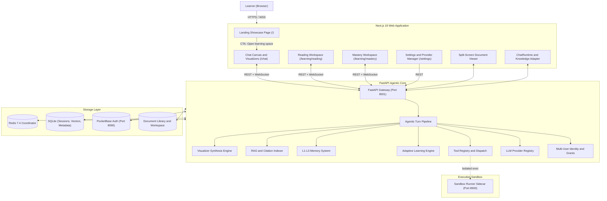
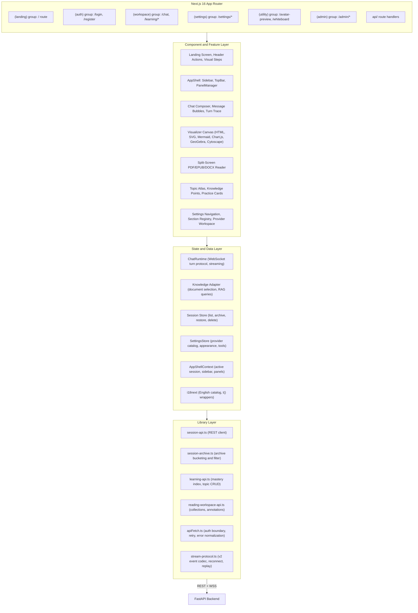
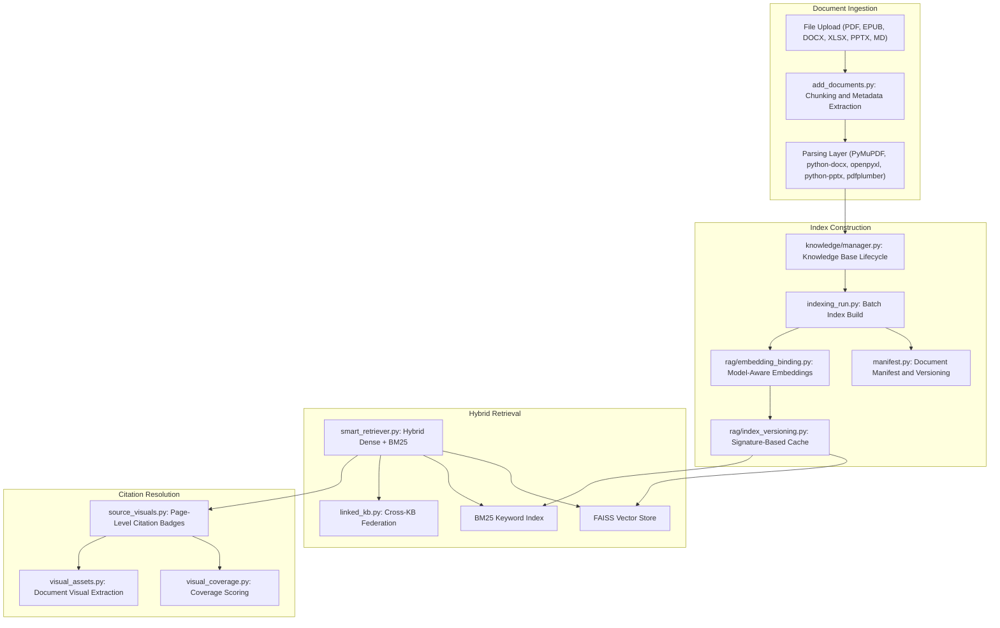
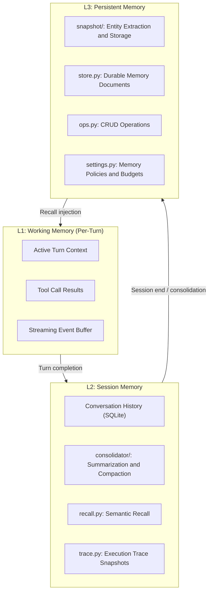
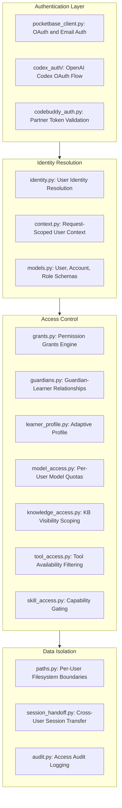
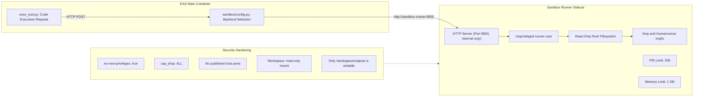
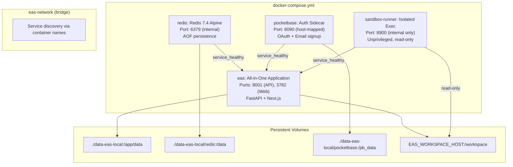
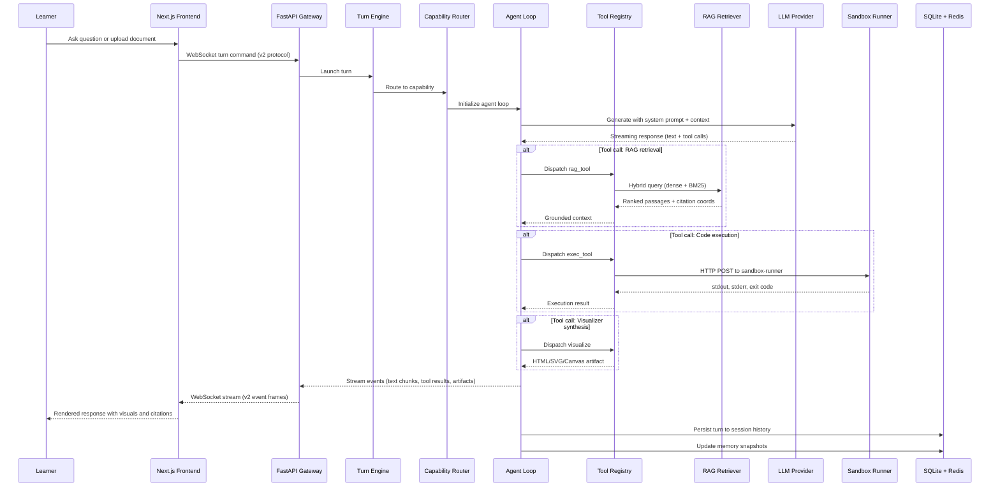

# EAS Technical Architecture

> Complete end-to-end architecture reference for the Educational Agentic System.

---

## High-Level System Topology

---

## Frontend Architecture

---

## Backend Agentic Turn Pipeline

```mermaid
graph LR
    subgraph Inbound ["Request Ingestion"]
        WS["WebSocket /api/v2/turns"]
        REST["REST /api/* endpoints"]
    end

    subgraph TurnPipeline ["Agentic Turn Engine"]
        Launcher["launcher.py: Turn Launcher"]
        Orchestrator["orchestrator.py: Capability Router"]
        BaseAgent["base_agent.py: ReAct Loop Core"]
        CapabilityReg["capability_catalog.py + registry.py"]
    end

    subgraph Capabilities ["Registered Capabilities"]
        ExploreCtx["explore_context: Open Q and A"]
        CourseStudy["course_study: Document-Grounded Chat"]
        Reading["reading: Reading Workspace Sessions"]
        Mastery["mastery: Mastery Learning Path"]
        Solve["solve: Step-by-Step Problem Solving"]
        AskQuestions["ask_questions: Interactive Quizzes"]
    end

    subgraph Agents ["Specialized Agent Loops"]
        ChatAgent["chat/ agent: Primary Tutor"]
        VisualizeAgent["visualize/ agent: Visualizer Synthesis"]
        ResearchAgent["research/ agent: Multi-Source Research"]
        QuestionAgent["question/ agent: Quiz Generation"]
        NotebookAgent["notebook/ agent: Note Compilation"]
        VisionAgent["vision_solver/ agent: Image Analysis"]
        MathAnimator["math_animator/ agent: Manim Rendering"]
    end

    subgraph ToolBelt ["Tool Registry"]
        WebSearch["web_search.py + web_fetch.py"]
        PaperSearch["paper_search_tool.py (ArXiv)"]
        RAGTool["rag_tool.py"]
        AskUser["ask_user.py (Interactive Choice Cards)"]
        ExecTool["exec_tool.py (Sandboxed Code Exec)"]
        MasteryNav["mastery_nav.py"]
        QuestionBank["question_bank.py"]
        WriteNote["write_note.py"]
        MediaGen["media_gen_tool.py"]
        Workspace["workspace.py"]
    end

    WS --> Launcher
    REST --> Launcher
    Launcher --> Orchestrator
    Orchestrator --> CapabilityReg
    CapabilityReg --> Capabilities
    Capabilities --> BaseAgent
    BaseAgent --> Agents
    Agents --> ToolBelt
```

---

## RAG and Knowledge Indexing Pipeline

---

## Memory Hierarchy (L1 to L3)

---

## Multi-User Identity and Access Control

---

## Sandbox and Code Execution Isolation

---

## Docker Service Orchestration

---

## Data and Request Flow

---

## Tech Stack and Codebase Structure

EAS is built as a full-stack monorepo with a clean separation between a Python backend and a TypeScript frontend, both living under `apps/eas/`.

**Backend (Python 3.11+, FastAPI):** The core is organized around a capability-driven agent architecture. The `eas/` Python package contains isolated modules for each domain: `agents/` holds the ReAct loop implementations for chat, research, visualization, and quiz generation; `capabilities/` maps learning scenarios (open exploration, document study, mastery paths) to the appropriate agent and tool set; `services/` provides infrastructure like the LLM provider registry, RAG pipelines, embedding management, memory consolidation, and session persistence; `runtime/` handles turn orchestration, Redis-backed event streaming, and worker coordination; and `learning/` implements the adaptive tutoring policies, spaced repetition scheduler, and mastery state machine. This modular layout means each subsystem can be tested and evolved independently, as validated by the 1,000+ backend test suite.

**Frontend (Next.js 16, React 19, TypeScript 5):** The web application uses the App Router with route groups to separate public landing pages, authenticated workspaces, settings, and admin surfaces. A strict three-layer architecture governs the codebase: `app/` contains only route definitions and page-level data fetching; `components/` and `features/` hold reusable UI primitives and domain-specific feature modules; `lib/` provides API clients, state adapters, and protocol codecs. All communication with the backend goes through a single `apiFetch` boundary that handles authentication, retry logic, and error normalization. Real-time streaming uses a custom v2 WebSocket protocol with sequence tracking, reconnect recovery, and durable replay.

**Storage:** Session data, vector indices, and metadata live in SQLite for zero-configuration portability. Redis 7.4 handles ephemeral coordination: event streaming, turn state, and singleflight caches. PocketBase provides optional OAuth and email authentication. The filesystem holds uploaded documents and workspace artifacts.

**Security:** Untrusted code execution is fully isolated in a dedicated sandbox runner sidecar. The runner container drops all Linux capabilities, runs read-only, enforces PID and memory limits, and is never exposed to the host network. The main application container never runs user-supplied code in its own process.

**Maintainability:** Architectural boundaries are enforced by automated dependency cruising (688 modules, 2,075 dependency edges, zero violations) and a comprehensive verification pipeline covering TypeScript type safety, ESLint, i18n catalog parity, API contract generation, and 1,036 frontend unit tests alongside the backend suite. Every settings page, tool registration, and capability binding follows a declarative registry pattern, making it straightforward to add new features without touching core orchestration code.
